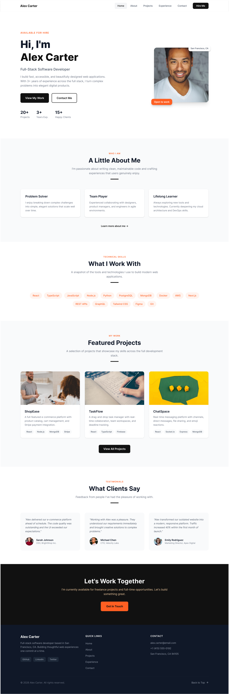
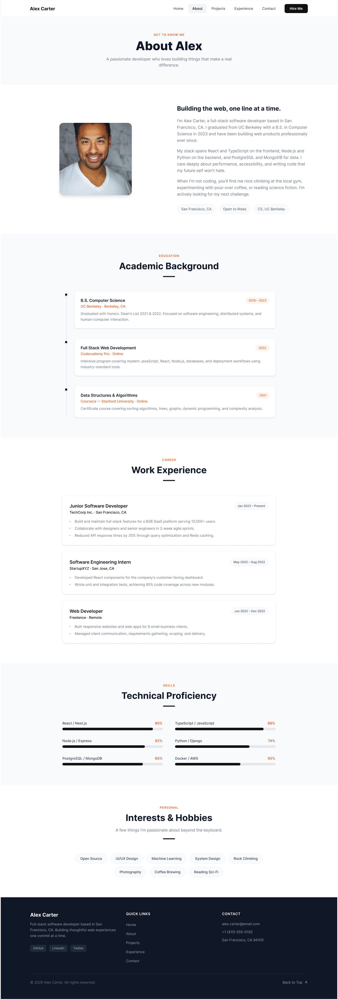
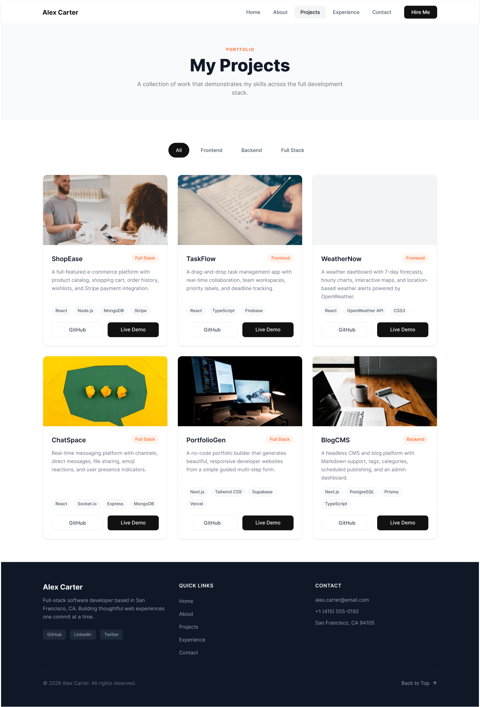
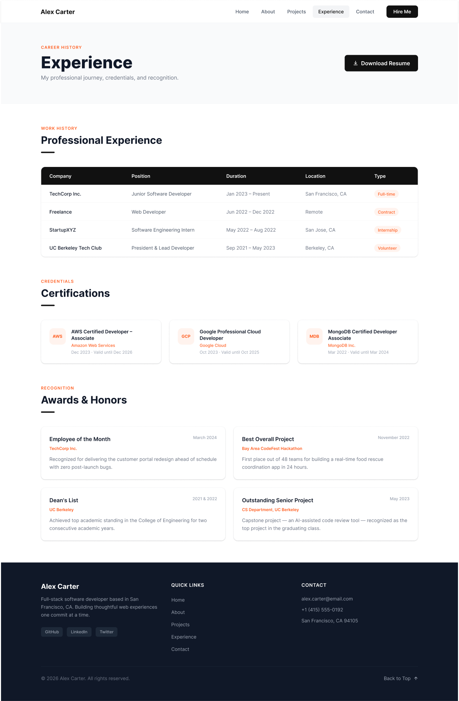
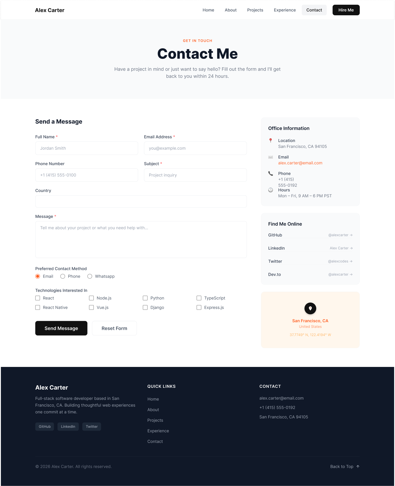

# Alex Carter Personal Website

## Introduction

Welcome to my alex carter website project! This website serves as a platform to showcase information about him, his open-source projects, writings, and contact information.

## Pages / Sitemap

I just create 5 page for visitor to learn about Alex Carter.

- [Home](#home): Overview of who is Alex Carter and what he do.
- [About](#about): About: Shares Alex Carter background, education, and journey into web development.
- [Projects](#projects): Showcases his personal projects with descriptions, tech stacks, and demo links.
- [Experience](#experience): Detailing his proffesional experience, certifications and awards / honors that he have.
- [Contact](#find-me): Provides a form and links to connect with me on social media.

## Tech Stack

- React.js
- Tailwind CSS

### Library

- React router
- tabler icons
- react-hook form
- uuid

## Links

- Website URL: [weekly21.netlify.app/](https://weekly21.netlify.app/)
- Github Repo: [github.com/bando9](https://github.com/bando9/bandomega.com)
- Figma File: [https://www.figma.com/design/pM87HcepfHfiVGoBlxIUaU/Personal-Profile?node-id=0-1&p=f&t=IsuW44XlZGTLTAEU-0](https://www.figma.com/design/pM87HcepfHfiVGoBlxIUaU/Personal-Profile?node-id=0-1&p=f&t=IsuW44XlZGTLTAEU-0)

## Preview

### Home

### About

### Projects

### Experience

### Contact

